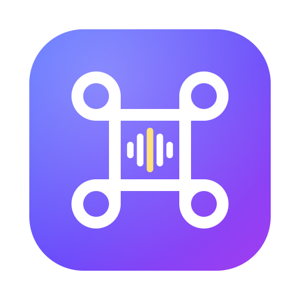
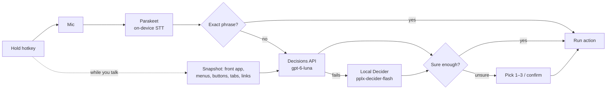

<p align="center"></p>

<h1 align="center">Mac Control</h1>

**Hold a key, say what you want, and your Mac does it.**

Mac Control is a menu-bar app for macOS that turns speech into actions across the whole system: open and quit apps, move and tile windows, click buttons and menu items in any app, drive your browser, change the volume or brightness, run your Shortcuts, and type by voice. Speech is transcribed **on your Mac** by NVIDIA Parakeet; the action is picked by a fast decision model (OpenAI's Decisions API, with Perplexity's local Decider as an offline fallback), and it runs instantly.

```
⌘ + Right ⌥  (hold)  →  "move this to my other monitor"  →  window moves   ·  ~0.5 s
```

A small overlay shows what it heard, what it picked, how confident it was, and how many milliseconds each step took.

---

## Highlights

- **Acts while you're still talking** — say "can you open up the Notes app and create a new note that says hello": Notes opens as you say "Notes", the note is created, and your words are typed in. A short pause runs what you've said; you never have to let go.
- **Hands-free** — tap the hotkey once and just talk: "open Notes" … "create a new note" … "now open X.com". Each pause runs a command; tap again or say "stop listening" to end. "Okay", "great", "thank you" are ignored.
- **Whole-Mac control** — apps, windows, menus, buttons, browser tabs and links, system settings, media, Shortcuts.
- **Fast** — on-device speech in ~50 ms; exact phrases ("open notes", "volume 40") skip the network entirely and run in microseconds; everything else is decided in ~0.3–0.8 s.
- **Private by default** — your voice never leaves the Mac. Only the transcript and a list of possible actions are sent to the decision model.
- **Safe** — risky actions (quit, lock, close window, Shortcuts) ask first when the model isn't sure; unclear commands show the top 3 to pick from; **"undo that"** reverses the last command.
- **Works offline** — if OpenAI is down, out of credits or not configured, Perplexity's Decider running locally takes over.
- **Chained commands** — "open Safari, make a new tab and set volume to 30".
- **Dictated text inside commands** — "…that says", "…saying", "type …" types the rest into the app you're working in.
- **Typing mode** — add ⇧ Shift to type what you say into any text field.
- **Macros** — "work mode" → open Slack, Mail and Chrome.

## Requirements

| | |
|---|---|
| macOS | 14 Sonoma or later (developed on macOS 27) |
| Mac | Apple Silicon (Parakeet runs on the Neural Engine) |
| Toolchain | Xcode Command Line Tools with Swift 6 (`xcode-select --install`) |
| Decision model | An OpenAI API key with access to the Decisions API (`gpt-6-luna`), **or** Perplexity's [Decider](docs/CONFIGURATION.md#local-decider-fallback) app running locally, or both |
| Disk | ~450 MB for the speech model (downloaded on first launch) |

## Quick start

```bash
git clone https://github.com/Ziad-NasrEldin/Mac-Control.git
cd Mac-Control
./build.sh                                           # builds and signs MacControl.app
ditto MacControl.app "/Applications/Mac Control.app"
open "/Applications/Mac Control.app"
```

On first launch the **Setup** window walks you through:

1. **OpenAI API key** — paste it; it's stored in your Keychain.
2. **Microphone** — allow it.
3. **Accessibility** — needed for the hotkey, windows, menus and key presses (System Settings → Privacy & Security → Accessibility).
4. **Speech model** — Parakeet downloads once (~450 MB) and then loads in under a second.
5. **Browsers** — the first time you switch tabs or click a link, macOS asks whether Mac Control may control your browser.

> The app installs as **Mac Control.app** (bundle id `io.github.ziadnasreldin.maccontrol`). Its menu-bar icon is a microphone with your remaining credit next to it. Upgrading from the earlier "Mac Control" build? Your settings, history, macros and API key move over automatically on first launch — see [Troubleshooting](docs/TROUBLESHOOTING.md#upgrading-from-voice-control).

## Using it

| Do this | To |
|---|---|
| Hold **⌘ + Right ⌥**, speak (pause or release) | Run a command — each pause runs what you've said so far |
| Tap **⌘ + Right ⌥** | Listen hands-free until you tap again or say "stop listening" |
| Hold **⇧ + ⌘ + Right ⌥**, speak, release | Type what you said into the focused field |
| Say **"undo that"** | Reverse the last command |
| Press **1–3** (or say "two") | Pick from the top 3 when a command was unclear |
| Press **Return** / **Esc** | Confirm / cancel a risky action |

Some things to say:

```
open notes                      switch to Safari                 quit Spotify
maximize                        move this to my other monitor    snap left
volume 40                       next song                        dark mode
go back                         go to the GitHub tab             search for flights to Cairo
switch to scientific mode       press seven                      export as PDF
make a QR code                  open Safari and make a new tab   lock screen
open Notes and create a new note that says call mom at six
```

The full list is in **[docs/COMMANDS.md](docs/COMMANDS.md)**.

## How it works



1. **While you talk** the mic records and Parakeet transcribes live every ~0.15 s; each finished clause ("open Notes **and**…") is decided and run right away, and so is the clause you're still saying once it's unambiguous ("open up the Notes…"). Meanwhile a TLS connection to OpenAI is warmed up, and the front app's menus, window controls, browser tabs and page links are read in the background.
2. **When you pause** (~0.7 s) or let go, Parakeet transcribes that utterance locally (~50 ms) and the rest of it runs.
3. **Exact phrases** are matched locally and run immediately — no API call.
4. **Everything else** goes to the decision model as one multiple-choice question: *which of these ~250 actions did the user mean?* The model returns a choice and a confidence.
5. **The action runs** through macOS APIs: NSWorkspace, the Accessibility API, Apple Events, synthesized key and media-key events.

Details: **[docs/ARCHITECTURE.md](docs/ARCHITECTURE.md)**.

## Cost

OpenAI's Decisions API bills **$0.10 per 1M uncached input tokens** and doesn't charge for output. A typical command is ~3,500 input tokens, of which ~2,100 are served from the prompt cache — roughly **$0.0002–0.0004 per command**, or a few tens of cents for a thousand commands. Exact phrases and the local Decider cost nothing. The menu bar shows an estimate of your remaining balance (set it once from the menu).

## Privacy

- Audio is processed only on your Mac and is never stored or uploaded.
- The decision model receives the **transcript**, the **front app's name**, the **current page title**, and the **list of possible actions** (your app names, menu items, button labels, tab titles, link texts). With the local fallback, nothing leaves the Mac.
- Your API key lives in the macOS Keychain.

More: **[docs/PRIVACY.md](docs/PRIVACY.md)**.

## Documentation

| | |
|---|---|
| [Commands](docs/COMMANDS.md) | Everything you can say |
| [Configuration](docs/CONFIGURATION.md) | Settings, hotkeys, speech models, local fallback, files on disk |
| [Architecture](docs/ARCHITECTURE.md) | How the pieces fit, request formats, design decisions |
| [Development](docs/DEVELOPMENT.md) | Building, signing, self-tests, releasing, adding commands |
| [Troubleshooting](docs/TROUBLESHOOTING.md) | Permissions, mic, API errors, and other fixes |
| [Privacy](docs/PRIVACY.md) | What is sent where |
| [Roadmap](docs/ROADMAP.md) | What's done and what's next |

## Status

All roadmap items except notarization and auto-updates are implemented and covered by 86 self-test checks in 17 suites that drive real apps, real audio and the real APIs (`./selftest.sh <name>`).

## License

No license has been chosen yet, so all rights are reserved by the author.
