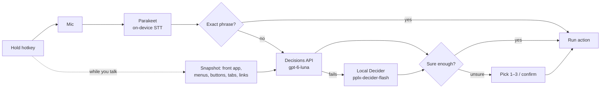

<p align="center"></p>

<h1 align="center">Mac Control</h1>

<!-- TODO: hero screenshot or short video of the overlay in action -->

**Hold a key, say what you want, and your Mac does it.**

Mac Control is a menu-bar app for Mac users who'd rather speak than hunt through menus: open and quit apps, move and tile windows, click buttons and menu items in any app, drive the browser, change the volume or brightness, run Shortcuts, and type by voice — with speech transcribed on your Mac.

## What you can do

- **Keep talking.** Say "open Notes and create a new note that says hello": Notes opens the moment you say "…and", the note is created, and your words are typed in.
- **Run the whole Mac.** Apps, windows, menus, buttons, browser tabs and links, system settings, media, Shortcuts.
- **Type by voice.** Add ⇧ Shift to type what you say into any text field, or drop dictated text into a command ("…that says", "…saying", "type …").
- **Chain it, or save it.** "open Safari, make a new tab and set volume to 30". Macros like "work mode" open Slack, Mail and Chrome.
- **Stay in control.** Risky actions (quit, lock, close window, Shortcuts) ask first when the model isn't sure; unclear commands show the top 3 to pick from; **"undo that"** reverses the last command.

## Try it

```bash
git clone https://github.com/Ziad-NasrEldin/Mac-Control.git
cd Mac-Control
./build.sh                                           # builds and signs MacControl.app
ditto MacControl.app "/Applications/Mac Control.app"
open "/Applications/Mac Control.app"
```

On first launch the **Setup** window walks you through:

1. **OpenAI API key** — paste it; it's stored in your Keychain.
2. **Microphone** — allow it.
3. **Accessibility** — needed for the hotkey, windows, menus and key presses (System Settings → Privacy & Security → Accessibility).
4. **Speech model** — Parakeet downloads once (~450 MB) and then loads in under a second.
5. **Browsers** — the first time you switch tabs or click a link, macOS asks whether Mac Control may control your browser.

The app installs as **Mac Control.app** (bundle id `io.github.ziadnasreldin.maccontrol`). Its menu-bar icon is a microphone with your remaining credit next to it. Upgrading from the earlier "Mac Control" build? Your settings, history, macros and API key move over automatically on first launch — see [Troubleshooting](docs/TROUBLESHOOTING.md#upgrading-from-voice-control).

Hold **⌘ + Right ⌥**, speak, release. Add **⇧ Shift** to type what you said into the focused field. If it isn't sure, press **1–3** (or say "two") to pick from the top 3; **Return** confirms a risky action and **Esc** cancels.

```
⌘ + Right ⌥  (hold)  →  "move this to my other monitor"  →  window moves   ·  ~0.5 s
```

Some things to say:

```
open notes                      switch to Safari                 quit Spotify
maximize                        move this to my other monitor    snap left
volume 40                       next song                        dark mode
go back                         go to the GitHub tab             search for flights to Cairo
switch to scientific mode       press seven                      export as PDF
make a QR code                  open Safari and make a new tab   lock screen
open Notes and create a new note that says call mom at six
```

The full list is in [Commands](docs/COMMANDS.md).

## How it works



1. **While you hold the key**, NVIDIA Parakeet transcribes live on your Mac every ~0.35 s; finished clauses run right away. A TLS connection to OpenAI is warmed up, and the front app's menus, window controls, browser tabs and page links are read in the background.
2. **When you let go**, Parakeet transcribes the audio locally (~50 ms).
3. **Exact phrases** ("open notes", "volume 40") match locally and run in microseconds — no API call.
4. **Everything else** is one multiple-choice question (~250 actions) to OpenAI's Decisions API (`gpt-6-luna`) and is decided in ~0.3–0.8 s; if OpenAI is down, out of credits or not configured, Perplexity's local Decider takes over. The model returns a choice and a confidence.
5. **The action runs** through macOS APIs: NSWorkspace, the Accessibility API, Apple Events, synthesized key and media-key events. A small overlay shows what it heard, what it picked, how confident it was, and how many milliseconds each step took.

Your voice never leaves the Mac. Only the transcript and a list of possible actions are sent to the decision model.

## Docs

- [Commands](docs/COMMANDS.md) — everything you can say
- [Configuration](docs/CONFIGURATION.md) — settings, hotkeys, speech models, local fallback, files on disk
- [Architecture](docs/ARCHITECTURE.md) — how the pieces fit, request formats, design decisions
- [Development](docs/DEVELOPMENT.md) — building, signing, self-tests, releasing, adding commands
- [Troubleshooting](docs/TROUBLESHOOTING.md) — permissions, mic, API errors, and other fixes
- [Privacy](docs/PRIVACY.md) — what is sent where
- [Roadmap](docs/ROADMAP.md) — what's done and what's next
- [Requirements](docs/REQUIREMENTS.md) — macOS, hardware, toolchain, disk, and cost

All roadmap items except notarization and auto-updates are implemented and covered by 86 self-test checks in 17 suites that drive real apps, real audio and the real APIs (`./selftest.sh <name>`).

## License

No license has been chosen yet, so all rights are reserved by the author.

---

Built by [Ziad Ahmed](https://github.com/Ziad-NasrEldin) at [MaVoid](https://mavoid.com).

[Website](https://mavoid.com) · [LinkedIn](https://linkedin.com/in/ziad-ahmed-634202332) · [GitHub](https://github.com/Ziad-NasrEldin)
